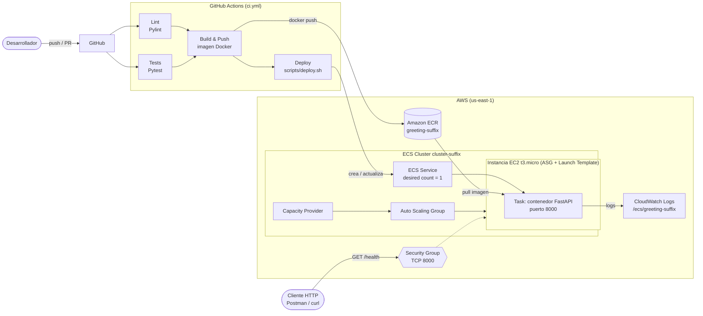
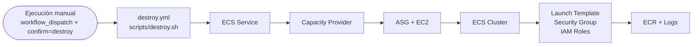
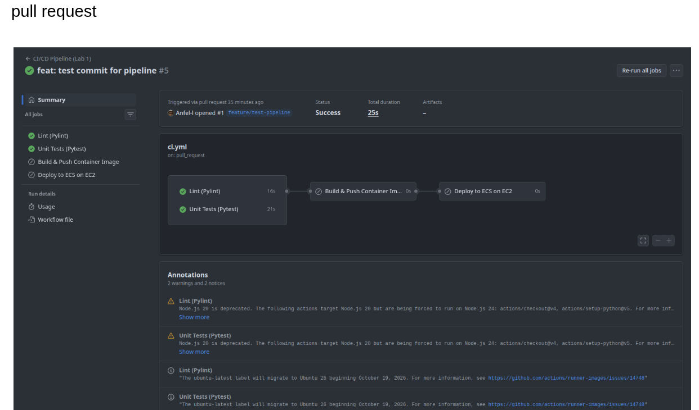
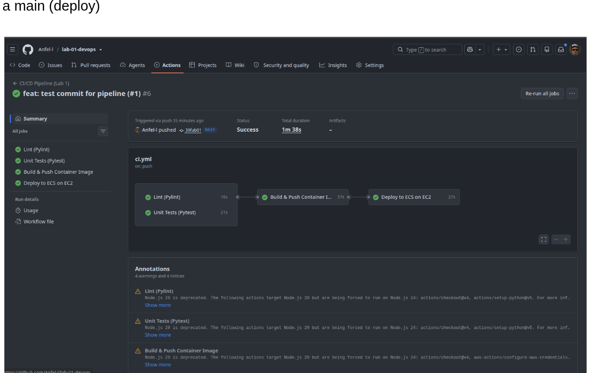
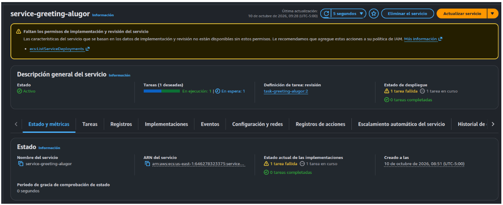
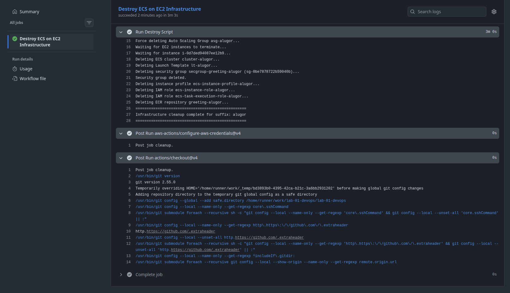
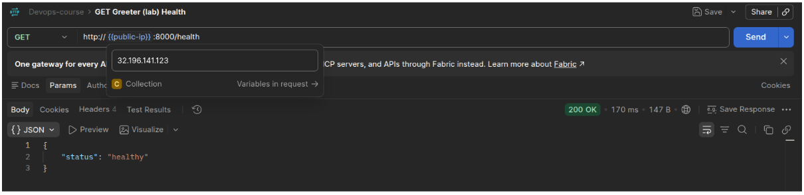
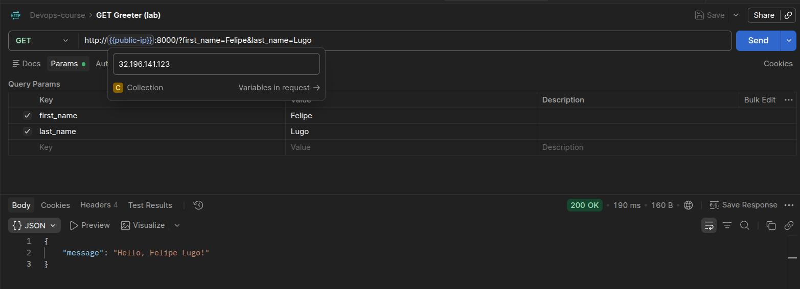

# Laboratorio 1 – CI/CD con GitHub Actions y contenedores en AWS

## 1. Arquitectura de contenedores y conceptos de CI/CD

### 1.1 Arquitectura de contenedores

<!-- Aplicación FastAPI (src/main.py) empaquetada con Dockerfile -> imagen en ECR -> ECS (EC2 launch type) -->

- **Aplicación y Dockerfile:** _(qué expone, puerto 8000, endpoints `/` y `/health`)_
- **Amazon ECR:** _(registro de imágenes, tags `latest` y `github.sha`)_
- **Amazon ECS sobre EC2:** _(cluster, task definition, service, capacity provider)_
- **Auto Scaling Group + Launch Template:** _(1 instancia t3.micro con AMI optimizada para ECS)_
- **Red y seguridad:** _(security group con puerto 8000 abierto, IAM roles de instancia y de ejecución de tareas)_





### 1.2 Conceptos de CI/CD aplicados

- **Integración continua (CI):** _(lint con Pylint, pruebas con Pytest en cada PR)_
- **Entrega/Despliegue continuo (CD):** _(build, push a ECR y despliegue a ECS en push a `main`)_
- **Disparadores:** _(`pull_request`, `push` a `main`, `workflow_dispatch`)_
- **Secrets y variables:** _(credenciales AWS, `STUDENT_SUFFIX`, `AWS_REGION`)_
- **Idempotencia de los scripts:** _(`deploy.sh` / `destroy.sh`)_

## 2. Evidencia de ejecución del pipeline

### 2.1 Pipeline automático para desplegar

- **Pull request** (solo lint y tests; build y deploy se omiten):

  

- **Push a `main`** (lint, tests, build & push, deploy):

  

- **Servicio en ECS** (`service-greeting-alugor`):

  

### 2.2 Pipeline manual para eliminar infraestructura

- Workflow: [destroy.yml](../.github/workflows/destroy.yml) (`workflow_dispatch`, requiere escribir `destroy`).

  


## 3. Evidencia de la petición HTTP a la IP pública

```bash
curl http://32.196.141.123:8000/health
```




```bash
curl 'http://32.196.141.123:8000/?first_name=Felipe&last_name=Lugo'
```




## 4. Propuestas para mejorar el pipeline

- **Autenticación sin llaves de larga duración:** usar OIDC de GitHub con un rol IAM en lugar de `AWS_ACCESS_KEY_ID`/`SECRET`.
- **Cache de dependencias** de Poetry y de capas Docker (`cache-from`/`cache-to`) para acelerar el pipeline.
- **Esperar estabilidad del despliegue:** `aws ecs wait services-stable` y smoke test a `/health` al final del deploy.
- **Rollback automático** con deployment circuit breaker de ECS.
- **Ambientes y aprobaciones:** GitHub Environments con revisores para deploy y destroy.
- **Permisos IAM mínimos** 
- **Infraestructura como código** (Terraform/CloudFormation) en lugar de scripts bash.
- **Escaneo de seguridad** de la imagen (ECR scanning / Trivy) y de dependencias.
- **Restringir el security group** y poner un Load Balancer / dominio en lugar de IP pública directa.
